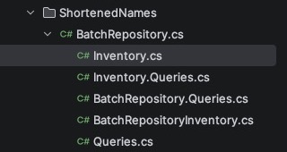
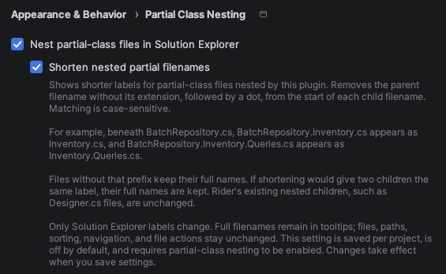

# Nest Partial Classes - Jetbrains Rider

Groups C# partial-class files in JetBrains Rider's Solution Explorer using their class declarations, rather than filename rules.

Files such as `CustomerRepository.Read.cs` and `Queries.cs` nest under `CustomerRepository.cs` when they belong to the same partial class.



## How it works

- Rider's .NET backend identifies matching partial classes; the frontend nests their files.
- Groups stay within the same project and logical folder. `ClassName.cs` is preferred as the parent; otherwise the first path in ordinal order is used.
- Namespace, containing types, generic arity, and the active compilation context determine which declarations match. Files mixing unrelated partial classes stay separate.
- Groups refresh after code edits, file changes, and project reloads. Existing Designer and `DependentUpon` nesting is preserved.
- Source files and project metadata are never changed.

## Install

Build the plugin, then choose **Settings → Plugins → Install Plugin from Disk** and select `build/distributions/rider-partial-nesting-0.2.0.zip`. Restart Rider.

## Settings

Open **Settings → Appearance & Behavior → Partial Class Nesting**. Rider's **File Nesting Settings** switch must also be enabled.

| Setting | Default | Behavior |
| --- | --- | --- |
| Nest partial-class files in Solution Explorer | On | Groups files that declare the same partial class. |
| Shorten nested partial filenames | Off | Shows `BatchRepository.Inventory.cs` as `Inventory.cs` beneath `BatchRepository.cs`. |

Shortening removes the parent's name followed by a dot, using an exact, case-sensitive match. Nonmatching names, conflicting labels, and Rider's existing nested children keep their full names. Full filenames remain in tooltips; navigation, sorting, and file actions are unchanged.

Settings are saved per project and apply when you save the settings dialog.



## Compatibility

- Targets Rider **2026.2.3.1** (build **262.10968.170**), limited to the **262** release line.
- Validated on **macOS with Apple Silicon**. Intel Macs, Windows, and Linux have not been tested.
- Supports C# partial classes. Other partial type kinds, cross-folder grouping, virtual source-generator files, and Remote Development are not supported.

## Build and test

Requires JDK 21 and .NET SDK 10. The Gradle wrapper downloads its dependencies and the pinned Rider SDK.

```sh
./gradlew check buildPlugin verifyPlugin
```

To reuse a local Rider installation on macOS:

```sh
./gradlew check buildPlugin verifyPlugin -PriderHome="$HOME/Applications/Rider.app/Contents"
./gradlew runIde -PriderHome="$HOME/Applications/Rider.app/Contents"
```

`runIde` opens the included sample solution in an isolated sandbox with separate settings, plugins, caches, and logs. Pass `-PsandboxSolution=/absolute/path/to/Your.sln` to use another solution.

The policy tests can also run independently:

```sh
dotnet test src/dotnet/PartialNesting.Tests/PartialNesting.Tests.csproj
```

## Source layout

- `src/dotnet/PartialNesting`: ReSharper semantic discovery and grouping policy.
- `src/rider/main`: native Solution Explorer integration and settings.
- `protocol`: RD contracts; C# and Kotlin bindings are generated during the build.
- `samples/PartialClasses`: manual integration cases.

Keep `riderVersion` in `gradle.properties` aligned with `JetBrains.Rider.SDK` in the backend project.

## Development references

- [Rider plugin development](https://plugins.jetbrains.com/docs/intellij/rider.html)
- [Official plugin template](https://github.com/JetBrains/resharper-rider-plugin)
- [ReSharper declared elements](https://www.jetbrains.com/help/resharper/sdk/DeclaredElements.html)
- [Rider extension points](https://plugins.jetbrains.com/docs/intellij/rider-extension-point-list.html)
